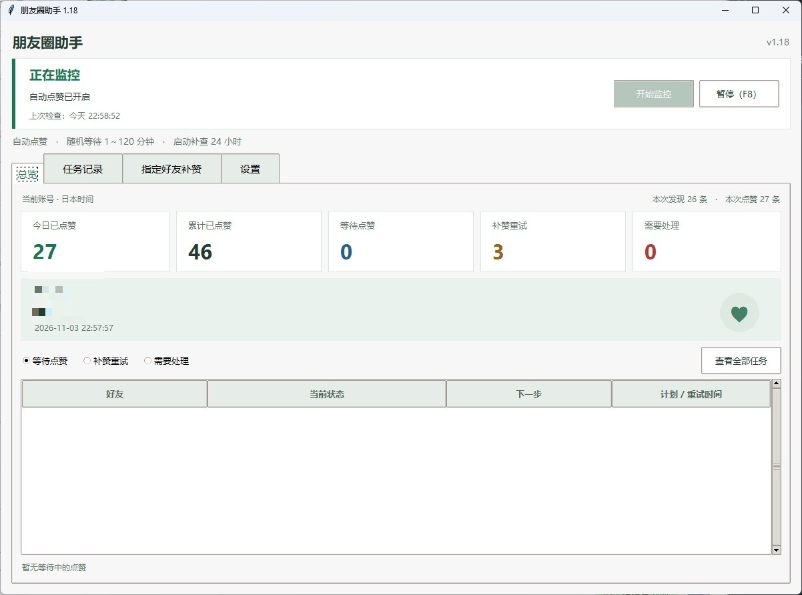
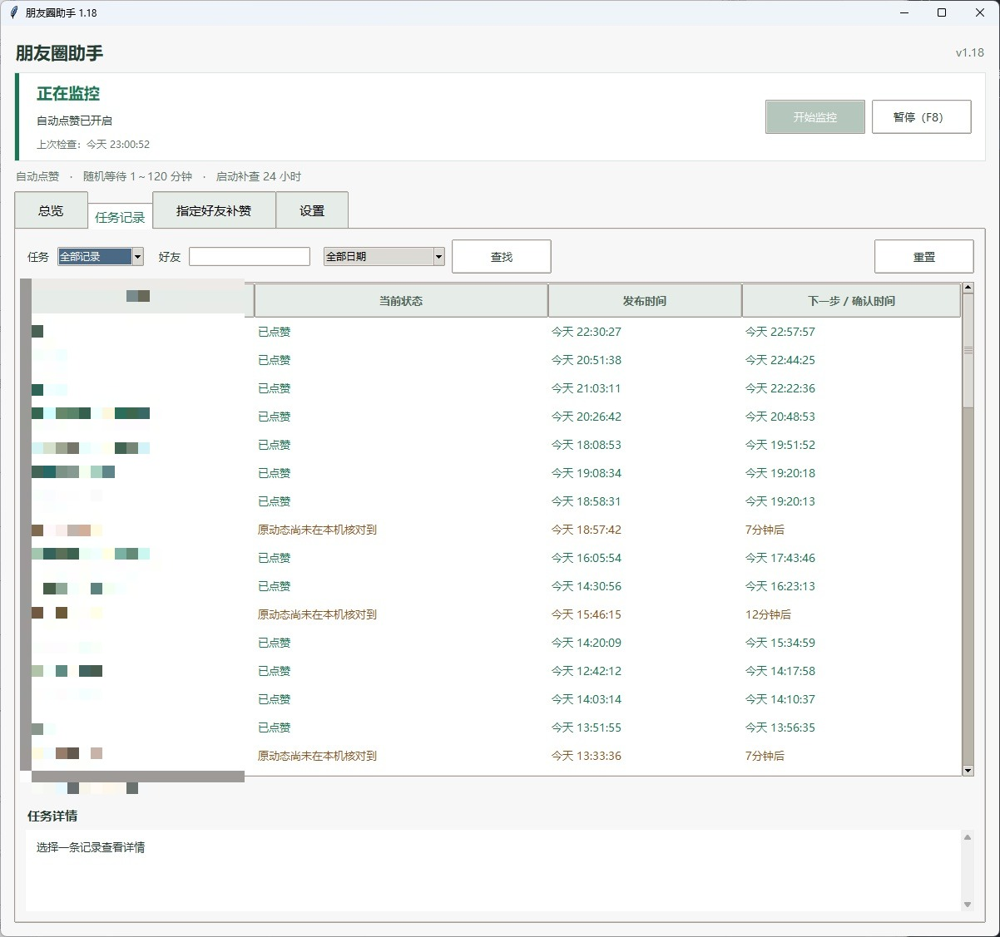
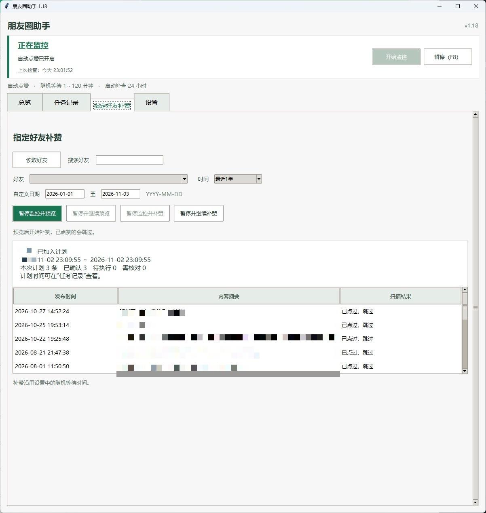

# 微信朋友圈点赞助手

给新朋友圈自动点赞，也能给指定好友补赞。后台运行，不占用鼠标键盘，可以继续玩游戏或做其他事情。

这是 **1.19 独立点赞版**，只提供朋友圈监控、读取、点赞和记录管理，**不包含 AI 自动回复、私聊收发或店铺问答**。无需 AI 模型、API Key 或付费授权。

## 界面预览

截图中的好友姓名和朋友圈内容已打码。

### 总览

查看运行状态、今日和累计点赞数，以及等待处理的任务。



<details>
<summary>查看任务记录</summary>

按好友、状态和日期查找记录，查看发布时间和点赞确认时间。



</details>

<details>
<summary>查看指定好友补赞</summary>

选择好友与日期，预览朋友圈后开始补赞。



</details>

截图展示 1.18 界面，1.19 沿用相同操作方式。

## 先看这里

| 项目 | 说明 |
| --- | --- |
| 运行环境 | Windows 64 位 |
| 微信版本 | **4.2.0.13**，同时校验程序文件，其他版本暂不支持 |
| 安装方式 | 下载程序压缩包，完整解压后运行，无需安装 Python |
| 点赞延迟 | 默认随机等待 1～120 分钟，可调整 |
| 支持范围 | 所有好友的新动态，或指定好友、指定日期内的可见动态 |
| 运行要求 | 电脑、微信和助手保持运行；暂停或关闭后不创建新点赞任务 |

**下载程序请看仓库的 Releases（发布版本），选择 `wechat-moments-monitor-v1.19-windows-x64.zip`。** GitHub 的“Code → Download ZIP”下载的是源码，不能直接当作程序运行。

当前版本已在开发者自己的电脑验证，尚未完成多台电脑的兼容性测试。项目独立于微信官方，使用非官方接口适配。

## 功能

- 所有好友的新动态监控，可设置不点赞名单，支持只监控。
- 首次启动补查最近 1～168 小时，默认 24 小时；已处理动态去重。
- 指定好友补赞：最近一年、30天、90天、全部可见、自定义起止日期。
- 补赞预览显示发布时间、文字摘要和处理状态；图片等无文字动态显示占位说明。
- 指定好友补赞单独执行，不自动启动所有好友监控。
- 随机延迟可调，默认 1～120 分钟，范围 1～1440 分钟；计划持久保存。
- 重启后继续未完成计划，错过的计划恢复后处理；已有点赞跳过。
- 今日/累计点赞、等待/重试任务、成功动效、发布/检测/计划/确认时间。
- 点赞结果不明确时保留状态，避免自动重复提交。

后台读取和点赞不截图、不切换微信窗口、不模拟鼠标键盘，不占用剪贴板。运行期间可以继续使用电脑。程序打开时保持停止，手动开始后才执行操作。

微信 4.2.0.9 用户可下载历史版本 1.18。

## 使用独立程序

1. 下载 Windows 程序压缩包并完整解压。
2. 登录匹配版本的电脑版微信，并在电脑版打开过朋友圈。
3. 打开 `MomentsMonitor` 文件夹，运行 `朋友圈后台监控助手.exe`。

保留旁边的 DLL、`_internal` 和许可证文件，不能只复制 exe。首次打开不会自动点赞；选择账号并开始监控或补赞后才执行。

尚无 Releases 下载时，也可从 Actions（自动构建）的成功任务中取得 `MomentsMonitor-windows-x64` 构建产物。

### 自动监控

1. 登录匹配版本的电脑版微信，并关闭其他正在执行朋友圈任务的助手副本。
2. 在设置中选择当前账号、检查补查范围和随机等待时间。
3. 点击“开始监控”。需要停止时点击“暂停”或在助手窗口按 F8。

### 指定好友、指定日期补赞

1. 进入“指定好友补赞”，监控时也可以使用好友选择。
2. 点击“读取好友”，搜索并从列表选择准确的好友。
3. 选择“最近1年”或自定义日期等范围；时间指**朋友圈的发布时间**。
4. 点击“预览朋友圈”，检查摘要、日期与数量；监控中会显示“暂停监控并预览”，点击后自动切换任务。
5. 点击“开始补赞”。按设置的随机等待范围执行，已有计划保留原时间。
6. 暂停或重新打开后，点击“继续补赞”。

只能读取当前账号实际可见、接口能够返回的动态；不能读取对方隐藏或已删除的内容。全部未读到时显示未确认，不把空响应直接当成扫描完成。每轮扫描最多500页，达到上限后可继续扫描。

更多说明见 [使用说明](docs/使用说明.md) 和 [实现说明](docs/实现说明.md)。

## 常见问题

**会影响我操作电脑吗？** 后台读取和点赞，不切窗口，不模拟鼠标键盘。

**关机后还会点赞吗？** 不会。计划会保留，重新打开后开始监控或继续补赞即可恢复处理。

**已经点过的会取消吗？** 不会，已点赞的动态会跳过。

**需要微信密码、API Key 或授权码吗？** 不需要填写这些信息，使用本机已经登录的微信账号。

**为什么提示版本不匹配？** 目前只适配微信 Windows 4.2.0.13，并校验程序文件。不会强制调用不匹配版本的接口。

**支持查看所有人的全部朋友圈吗？** 只能处理你的账号实际可见且接口能返回的动态，无法读取隐藏或已删除的内容。

**会上传好友或朋友圈内容吗？** 本程序没有 AI 服务或数据上传功能，设置和任务记录保存在本机。微信自身的刷新与点赞仍通过微信服务完成。

## 从源码构建

需要 Windows x64、Python 3.12，以及 Visual Studio C++ Build Tools 的“使用 C++ 的桌面开发”组件。可通过 `VCVARS64` 指定 `vcvars64.bat`。

```powershell
python -m venv .venv
.\.venv\Scripts\python.exe -m pip install -r requirements-build.txt
.\.venv\Scripts\python.exe -m unittest discover -s tests -v
.\.venv\Scripts\python.exe tools\check_ui_hidden.py
.\.venv\Scripts\python.exe tools\audit_source.py
.\.venv\Scripts\python.exe tools\build.py
```

输出：`dist/MomentsMonitor`。构建不需要微信程序文件，也不会把微信安装文件打进程序。若已加载同一路径的原生组件，先退出微信再重编，避免覆盖正在使用的 DLL。

本仓库包含 GitHub Actions 的 Windows 构建流程。推送代码后运行离线测试和构建，产物在该次 Actions 的 Artifacts 中下载；工作流不会执行真实点赞，也不会自动创建公开 Release。

## 数据与分享

运行设置、去重记录、预览朋友圈和任务日志保存在程序旁的 `data/`，包括账号标识、好友显示名以及预览摘要。数据库读取密钥仅在内存中使用；临时解密缓存正常退出时清理。

分享时使用干净构建产物。源码发布排除 `data/`、数据库、日志、缓存、请求文件、凭据和本地构建文件；`.gitignore` 与源码检查工具已提供。源码检查只能辅助检查，不能替代审阅新增文件。

该独立项目不包含 AI 自动回复、店铺问答、个人微信数据或私下更新的签名密钥。若从整合版迁移自己的记录，先关闭旧程序，再在本机把对应朋友圈模块的 `data` 复制到独立程序旁；这些运行数据不属于公开源码或 Release。

## 实现与兼容性

联系人和朋友圈读取代码基于 [fanyuantaier/wechatauto-replica](https://github.com/fanyuantaier/wechatauto-replica)，保留 Apache-2.0 许可证和修改说明。实际程序限定读取 `contact.db` 和 `sns.db`，不提供私聊收发功能。

刷新与点赞组件会加载到本机已登录的微信进程，调用微信原生任务队列；属于进程内的非官方接口适配，没有本地 HTTP/WebSocket 服务。组件可以驻留到微信退出。暂停或关闭助手后停止创建新任务，已经提交的操作会先核对结果。

当前适配文件的 SHA-256：

```text
afe3d02c58bada3c35009c0cd58ee1f57b2a00fe53237d0dce649107fddb9a20
```

源码仅包含适配特征与调用代码，不包含 `Weixin.dll`。点赞成功依据本机记录回读确认，不是另行查询的服务器时间。当前界面时间使用 UTC+9。

## 许可证

项目采用 [Apache License 2.0](LICENSE)。第三方来源及修改说明见 [NOTICE](NOTICE) 和 [LICENSES](LICENSES)。`native/json.hpp` 为 JSON for Modern C++，保留 MIT 许可证。
